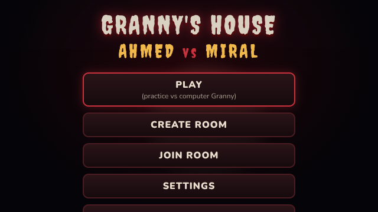
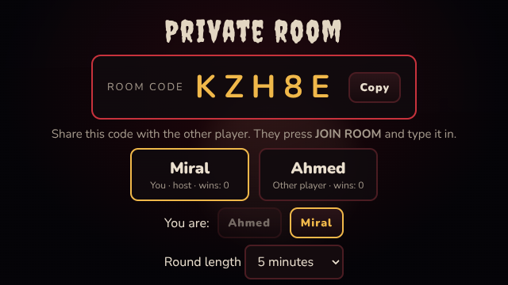
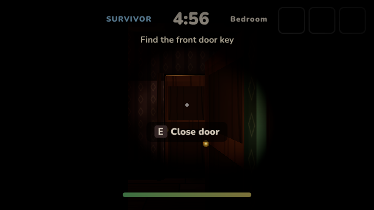
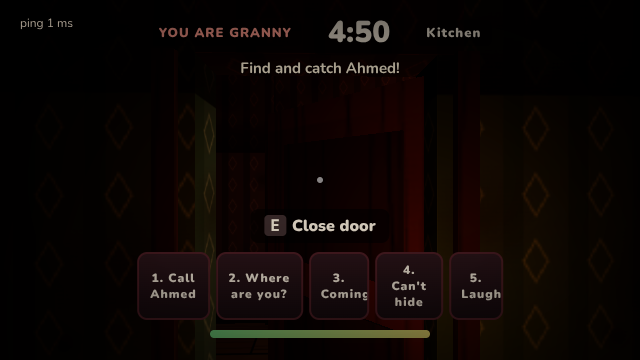
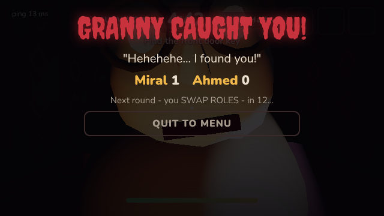

# GRANNY'S HOUSE: AHMED vs MIRAL

A spooky-but-funny first-person **two-player** horror game for kids (8–12).
One player is **Granny** 👵, the other is the **survivor** who must find the key
and escape the haunted house. After every round the players **swap roles**.

- 🎮 Plays in the browser, on **Windows** (EXE) and **Android** (APK).
- 🌐 **Online multiplayer**: private room codes, two devices, authoritative Node.js server.
- 🤖 **Practice mode**: play alone against a computer-controlled Granny (works offline).
- ⌨️🖱️ Keyboard + mouse and 📱 touch controls.
- No gore, no weapons: Granny just catches you. Scare level is adjustable.

| Menu | Lobby | Survivor | Granny | Caught! |
| --- | --- | --- | --- | --- |
|  |  |  |  |  |

<sub>Screenshots from the automated test (small window, low graphics, software rendering).</sub>

> Status: **Phase 1 (playable prototype) + Phase 2 core (two-player online)**.
> See [Roadmap](#roadmap) for what's next.

---

## Install / play (no developer tools needed)

### Android and Windows apps
Every push to `main` builds the apps automatically and puts them on the
**[Releases page](https://github.com/shrider-bit/Ansd/releases/tag/latest)**:

| Device | File | How |
| --- | --- | --- |
| Android | `GrannysHouse.apk` | Download on the phone and open it. Allow "install unknown apps" for your browser when asked. |
| Windows | `GrannysHouse-Portable.exe` | Download and double-click. No install needed. (Windows SmartScreen may warn because the app isn't code-signed: *More info → Run anyway*.) |
| Windows | `GrannysHouse-Setup.exe` | Optional installer with a Start-menu shortcut. |

Practice mode works straight away. **Online play needs the game server** (next section).

### Online play: deploy the game server once (free, ~5 minutes, all in the browser)
The server keeps the two players in sync and decides who caught whom.

1. Create a free account at [render.com](https://render.com) (sign in with GitHub).
2. **New → Blueprint →** choose this repository. Render reads `render.yaml` and deploys it.
3. When it's live you get a URL like `https://grannys-house.onrender.com`.
   **Opening that URL in any browser is already the full game, multiplayer included.**
4. To make the APK/EXE use your server: on GitHub go to **Settings → Secrets and variables →
   Actions → Variables → New repository variable**, name `GAME_SERVER_URL`, value
   `wss://grannys-house.onrender.com/ws`. The next build bakes it in. (Players can also type the
   server address in the game's **SETTINGS** screen.)

Free Render servers sleep after ~15 minutes without players; the first connection
then takes up to a minute to wake up.

A `Dockerfile` is included for other hosts (Fly.io, Railway, any VPS).

### How to start a two-player game
1. Ahmed (or Miral) presses **CREATE ROOM**, picks a character and reads out the 5-letter code.
2. The other player presses **JOIN ROOM** and types the code (or opens the shared link).
3. The host presses **START MATCH**. Roles are random for round 1 and **swap every round**.

---

## How to play

**Survivor:** find the key (it's in a random place each round), unlock the front door
and escape. Hide in wardrobes, the pantry or under the bed. Running is fast but loud and tiring.

**Granny:** listen for footsteps and doors, call the survivor by name with the voice
buttons, search hiding spots and catch the survivor before time runs out.

A round ends when Granny catches the survivor (Granny scores), the survivor escapes
(survivor scores) or the time runs out (draw).

| | Keyboard / mouse | Touch |
| --- | --- | --- |
| Move | WASD / arrows | Left thumb |
| Look | Mouse (click the game to capture it) | Right thumb drag |
| Run | Shift | RUN (hold) |
| Crouch | C | DUCK |
| Use / open / hide / search | E | USE |
| Flashlight | F | LIGHT |
| Granny's voices | 1–5 or the on-screen buttons | on-screen buttons |
| Pause | Esc | II |

**Settings** (saved on the device): volume, scare level (Mild / Normal / Scary),
*softer sudden loud sounds* (independent of scare level), Granny's voice language
(English / Arabic) and pitch, look sensitivity, invert look, graphics quality, FPS counter,
server address.

---

## For developers

The whole project runs in the cloud (GitHub Actions, Render); nothing needs to be
installed on your own computer. To work locally anyway you need Node.js 20+.

```bash
npm install
```

```bash
npm run dev:server
```

```bash
npm run dev
```

`dev:server` starts the multiplayer server on port 8080 and `dev` starts the Vite dev
server, which proxies `/ws` to it. Open the printed URL in two browser windows to
test online play. Other scripts:

| Script | What it does |
| --- | --- |
| `npm run build` | Typecheck, build the web game (`dist/`) and the server (`dist-server/`). |
| `npm start` | Run the built server; it also serves the game at `http://localhost:8080`. |
| `npm test` | Unit tests (rules engine, rooms, anti-cheat, level, AI senses). |
| `npm run e2e` | End-to-end test in headless Chromium: practice round + full two-player online match (needs `npm run build` first). |

### Project layout

```
src/
  shared/      Code used by BOTH the server and the browser
    level.ts       House layout (walls, doors, furniture, hiding spots, key spots, AI waypoints)
    geometry.ts    2D line-of-sight / wall checks (server-side validation)
    match.ts       One round: authoritative rules (doors, key, hiding, catching, escaping, timer, anti-cheat)
    room.ts        Private room: lobby, characters, rounds, scores, role swap, reconnection
    protocol.ts    Network messages + input validation
    nav.ts         A* path finding for the computer Granny
    voiceLines.ts  Granny's English + Arabic lines
  game/        3D client (Three.js + Rapier physics)
    Game.ts        Scene, frame loop, networking glue, remote player, atmosphere
    world.ts       Builds meshes + colliders from level.ts
    player.ts      First-person controller (walk / run / crouch / stamina)
    bot.ts         Computer Granny for practice mode
    audio.ts       Procedural 3D audio (footsteps, creaks, doors, thunder, heartbeat, chase music)
    voice.ts       Granny's voice (recorded files if present, else built-in speech)
    models.ts      Low-poly Granny / Ahmed / Miral with walk animation
    input.ts       Keyboard, mouse, touch joystick
  net/session.ts Online (WebSocket, auto-reconnect) and Practice (in-browser room) sessions
  ui/            HUD + styles;  main.ts = menus and app flow
server/index.ts  Node HTTP + WebSocket server (rooms, rate limits, static files)
desktop/         Electron wrapper for the Windows EXE
scripts/         Android build script, end-to-end test
.github/workflows/  CI (tests), Build apps (APK + EXE → Releases), optional GitHub Pages
```

### Multiplayer design
- **Authoritative server**: the room decides door states, who has the key, hiding,
  catches, escapes, timer and scores. Clients only send inputs/positions.
- **Anti-cheat basics**: every message is schema-validated; movement is checked against a
  speed budget and against walls/closed doors (teleports and wall-walking are rejected and
  corrected); interactions must be in range and allowed for your role; Granny is never sent
  the hidden survivor's position; rate limiting and payload size limits.
- **Privacy**: no accounts, no names typed, no public matchmaking. Rooms are private
  5-character codes and disappear when empty. Only "Ahmed" / "Miral" are shared.
- **Reconnection**: a dropped player has 2 minutes to come back (the round pauses);
  reloading the page rejoins automatically.
- **Secure connections**: when the game is served over HTTPS (Render does this
  automatically) it connects with `wss://`.

### Android signing (optional)
Without secrets the APK is debug-signed. For a proper release key add these repository
secrets: `ANDROID_KEYSTORE_BASE64`, `ANDROID_KEYSTORE_PASSWORD`, `ANDROID_KEY_ALIAS`,
`ANDROID_KEY_PASSWORD`.

### Replacing Granny's placeholder voice
See [docs/AUDIO.md](docs/AUDIO.md).

---

## Roadmap

- [x] **Phase 1** – small haunted house, first-person movement, doors, lighting, sound, keyboard + touch.
- [x] **Phase 2 (core)** – create/join room, Ahmed & Miral, shared world, roles, catching, auto role swap, reconnection.
- [ ] **Phase 3** – full mansion: first floor, attic, basement, garden, secret passages.
- [ ] **Phase 4** – recorded Granny voices, Granny abilities (Ghost Vision, Door Lock, Fake Footsteps, Blackout), more jump scares.
- [ ] **Phase 5** – tools, puzzles, locked rooms, second escape route (basement tunnel).
- [ ] **Phase 6** – better models and animations, performance tuning on real phones.

All 3D models, textures and sounds are original and generated in code, so there are
no third-party asset licences to worry about.
